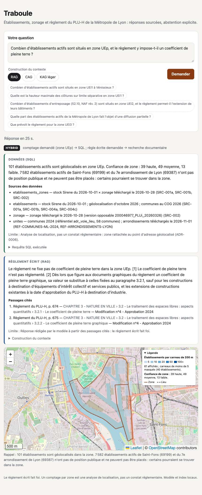
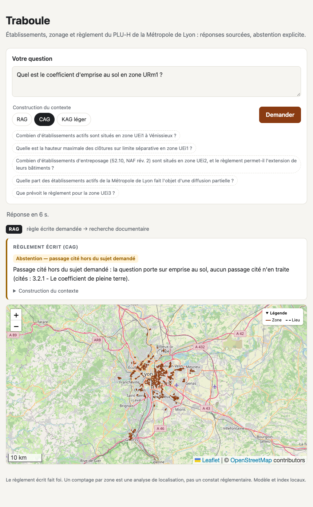
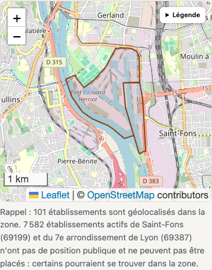
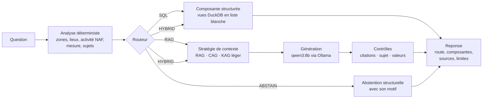
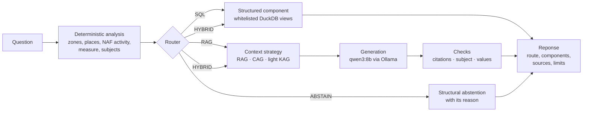

# Traboule

**Un assistant local qui répond, sources à l'appui, aux questions sur les établissements, le zonage et les règles d'urbanisme de la Métropole de Lyon.**<br>
*A local assistant that answers questions about businesses, zoning and planning rules in the Lyon Metropolitan Area, with cited sources.*

[](LICENSE)
[](pyproject.toml)

**🇫🇷 [Français](#fr) · 🇬🇧 [English](#en)**

---

<a id="fr"></a>

## 🇫🇷 Français



*L'interface web (`traboule serve`) sur une vraie question : le comptage des établissements de la zone UEp avec la ventilation de confiance, la règle du coefficient de pleine terre citée à la page, et la carte de la zone avec le carroyage des établissements.*



*Une réponse bloquée, en CAG : pour une question sur l'emprise au sol en zone URm1, le modèle citait l'article sur la pleine terre. La carte montre la zone visée. En CAG, la première question sur une zone prend jusqu'à 5 min, le temps de lire son chapitre (3 min 51 s pour URm1) ; les suivantes sur la même zone, quelques secondes (6 s pour cette capture).*



*La carte sur mobile : légende repliée, et rappel des établissements qui ne peuvent pas être placés.*

### Ce que fait Traboule

Traboule est un assistant qui fonctionne entièrement en local. Il répond à des questions sur les établissements, le zonage et les règles d'urbanisme de la Métropole de Lyon.

Il combine trois sources de réponse :
- des requêtes SQL sur des données officielles : le répertoire Sirene des entreprises et de leurs établissements, tenu par l'INSEE (Institut national de la statistique et des études économiques), et les référentiels géographiques ;
- une jointure spatiale entre la position des établissements et le zonage du PLU-H (plan local d'urbanisme et de l'habitat de la Métropole de Lyon) ;
- une recherche dans le règlement écrit et les cahiers communaux du PLU-H.

Chaque réponse cite ses sources. Quand les données ne suffisent pas, Traboule s'abstient et dit pourquoi.

### Ce qui le distingue

- **La chaîne établissement → zone → règle écrite.** Une même réponse compte les établissements d'une zone du PLU-H et cite la règle du chapitre de cette zone.
- **Un indice de confiance de zone et un minorant.** Chaque établissement placé dans une zone reçoit une confiance (haute, moyenne ou faible) selon sa distance à une autre zone ([ADR-0006](docs/decisions/ADR-0006-source-coordonnees-indice-confiance.md) ; un ADR, *architecture decision record*, consigne une décision dans [`docs/decisions/`](docs/decisions/)). Les établissements sans position publique ne sont pas ignorés : la réponse dit combien, dans la commune ou l'arrondissement concerné, ne peuvent pas être placés, et que certains pourraient se trouver dans la zone.
- **Une carte sous la réponse.** Les zones citées, le contour du lieu et, pour un comptage, un carroyage de 200 m : jamais un point d'établissement.
- **Des citations à la page, avec la version de la pièce.** Chaque passage cité donne son document, sa page et la procédure qui l'a fixé, par exemple « Modification n°4 - Approbation 2024 ».
- **Le blocage des réponses que le passage cité ne soutient pas.** Une réponse est écartée si aucun passage cité ne porte sur le sujet demandé, ou si un nombre de la réponse ne figure pas dans les passages cités.
- **Tout tourne sur un ordinateur portable** (Apple M2, 16 Go), sans API distante à l'exécution : le modèle de langage qwen3:8b est servi par Ollama, l'index vectoriel Qdrant est embarqué, les données sont dans une base DuckDB.

### Démonstration

Sorties réelles de `traboule ask` dans le terminal, sur la base de référence (stock Sirene du 2026-10-01) ; raccourcies, `…` marque une coupure. Une reconstruction aujourd'hui donne d'autres chiffres (voir le démarrage rapide). En ligne de commande : `uv run traboule ask "…"`, avec `--strategie rag|cag|kag` et `--json` pour l'objet `Reponse` brut.

**Une question mixte (route HYBRID : données et règle écrite).**

```text
$ uv run traboule ask "Combien d'établissements actifs sont situés en zone UEp, et le règlement y impose-t-il un coefficient de pleine terre ?"
Route : HYBRID · stratégie RAG — comptage demandé (zone UEp) → SQL ; règle écrite demandée →
recherche documentaire
╭─ Données (SQL) ──────────────────────────────────────────────────────────────────────────────────╮
│ 101 établissements actifs sont géolocalisés en zone UEp. Confiance de zone : 39 haute, 49        │
│ moyenne, 13 faible. 7 582 établissements actifs de Saint-Fons (69199) et du 7e arrondissement de │
│ Lyon (69387) n'ont pas de position publique et ne peuvent pas être placés : certains pourraient  │
│ se trouver dans la zone.                                                                         │
│ Source : etablissements_zones — stock Sirene du 2026-10-01 × zonage téléchargé le 2026-10-28     │
│ (SRC-001a, SRC-001b, SRC-002)                                                                    │
│ …                                                                                                │
│ Limite : Analyse de localisation, pas un constat réglementaire : zone rattachée au point         │
│ d'adresse géolocalisé (ADR-0006).                                                                │
╰──────────────────────────────────────────────────────────────────────────────────────────────────╯
╭─ Règlement (RAG) ────────────────────────────────────────────────────────────────────────────────╮
│ Le règlement ne fixe pas de coefficient de pleine terre dans la zone UEp. [1] Le coefficient de  │
│ pleine terre n'est pas réglementé. [2] Dès lors que figure aux documents graphiques du règlement │
│ un coefficient de pleine terre graphique, sa valeur se substitue à celles fixées au paragraphe   │
│ 3.2.1, sauf pour les constructions à destination d'équipements d'intérêt collectif et services   │
│ publics, et les extensions de constructions existantes à la date d'approbation du PLU-H à        │
│ destination d'industrie.                                                                         │
│ [1] Règlement du PLU-H, p. 674 — CHAPITRE 3 - NATURE EN VILLE > 3.2 - Le traitement des espaces  │
│ libres : aspects quantitatifs > 3.2.1 - Le coefficient de pleine terre — Modification n°4 -      │
│ Approbation 2024                                                                                 │
│ [2] Règlement du PLU-H, p. 675 — CHAPITRE 3 - NATURE EN VILLE > 3.2 - Le traitement des espaces  │
│ libres : aspects quantitatifs > 3.2.2 - Le coefficient de pleine terre graphique — Modification  │
│ n°4 - Approbation 2024                                                                           │
│ …                                                                                                │
╰──────────────────────────────────────────────────────────────────────────────────────────────────╯
```

**Une réponse bloquée (contrôle du sujet).** Le modèle répondait « au minimum de 25 % » en citant l'article 3.2.1 sur le coefficient de pleine terre, alors que l'article 2.4.1 de la zone URm1 dit « L'emprise au sol des constructions n'est pas réglementée » (p. 325).

```text
$ uv run traboule ask "Quel est le coefficient d'emprise au sol en zone URm1 ?" --strategie cag
Route : RAG · stratégie CAG — règle écrite demandée → recherche documentaire
╭─ Règlement (CAG) ────────────────────────────────────────────────────────────────────────────────╮
│ Abstention — passage cité hors du sujet demandé                                                  │
│ Passage cité hors du sujet demandé : la question porte sur emprise au sol, aucun passage cité    │
│ n'en traite (cités : 3.2.1 - Le coefficient de pleine terre).                                    │
│ Contexte : CAG : chapitre URm1 en entier (70 passages, 19481 tokens), sans les passages de la    │
│ partie I ; cache 028a2815ce4994b1 réutilisé (4e utilisation)                                     │
│ …                                                                                                │
│ Contexte : Réponse du modèle écartée : Le coefficient d'emprise au sol en zone URm1 est au       │
│ minimum de 25%.                                                                                  │
╰──────────────────────────────────────────────────────────────────────────────────────────────────╯
```

### Démarrage rapide

**Prérequis**

- macOS, testé sur Apple M2 avec 16 Go de mémoire ; Linux n'a pas été testé.
- Python 3.12, [uv](https://docs.astral.sh/uv/) et [Ollama](https://ollama.com).
- Le dépôt cloné : `git clone https://github.com/2501Pr0ject/traboule.git && cd traboule`.
- Environ 20 Go de disque : données brutes 4,2 Go, données intermédiaires 0,1 Go, base et index 0,3 Go, modèle qwen3:8b 5,2 Go, modèle d'encodage BGE-M3 en cache 8,5 Go, environnement Python 1,8 Go.
- 16 Go de mémoire suffisent. À l'usage, le serveur Ollama occupe 6,3 Go avec une fenêtre de 16 384 tokens (RAG, KAG) et 6,8 Go avec 22 528 tokens (CAG) ; le processus `traboule ask` culmine à 2,9 Go en RAG. Pendant la construction, les pics mesurés atteignent 4,8 Go (Sirene) et 4,3 Go, plus 2,2 Go de mémoire graphique (index).

**Installer, construire, lancer**

```bash
make setup              # environnement Python (uv sync --all-extras)
ollama pull qwen3:8b    # modèle de langage, 5,2 Go
make download           # 9 sources, 4,2 Go
make build              # données, base et index
uv run traboule serve   # interface web sur http://127.0.0.1:8000
```

`make download` place chaque source dans `data/raw/` : une ressource encore identique à la version de référence (même empreinte sha256) rejoint son dossier daté ; une ressource modifiée à la source va dans un dossier daté du jour, et l'écart est signalé ; relancée après une interruption, la commande garde les ressources déjà présentes et télécharge les autres. `make build` enchaîne les dix étapes de la construction, du référentiel géographique à l'index, et s'arrête à la première erreur. Sur une construction déjà faite, il s'arrête dès la première étape (sorties existantes) ; `make build FORCE=1` reconstruit tout, extraction des PDF comprise. Lancés seuls, le règlement et les cahiers réécrivent leurs passages en reprenant l'extraction en cache d'un PDF inchangé (même empreinte sha256) ; les ligatures, les renvois et l'index sont toujours refaits. Le stock et la géolocalisation Sirene doivent être du même mois : sinon, la construction s'arrête et indique quoi retélécharger.

**Durées mesurées** dans un clone neuf, sur la machine de référence, modèles et paquets déjà en cache : `make download` a pris 7 min 18 s, puis 15 min 36 s lors d'une seconde reconstruction marquée par une coupure réseau (la relance a gardé les ressources déjà téléchargées) ; la construction, 1 h 37 min, puis 1 h 14 min de calcul avec `make build`, dont 37 à 42 min pour les 76 cahiers (Docling) et 29 à 48 min pour l'index. La première question en RAG a pris 49 s, chargement du modèle compris. Le premier téléchargement des modèles (environ 14 Go) s'ajoute à ces durées et n'a pas été mesuré. Une mise en veille suspend la construction : sur macOS, la lancer avec `caffeinate -i make build`. Détail par étape : [docs/reconstruction.md](docs/reconstruction.md).

> [!NOTE]
> **Une reconstruction aujourd'hui donne d'autres chiffres que les exemples de ce README.** Les sources ne sont pas archivées : le stock Sirene est mensuel, le fichier de géolocalisation ne reste en ligne qu'un mois, et le zonage est servi tel qu'il est le jour du téléchargement. La reconstruction du 2026-11-22 a lu le stock de novembre 2026 : la zone UEi1 à Vénissieux y compte 1 487 établissements actifs au lieu de 1 479. Les réponses citent alors la version réellement lue (« stock Sirene du 2026-11-01 »).

### Fonctionnement



- **Analyse.** Sans modèle, elle repère dans la question les codes de zone, les communes et arrondissements, l'activité selon la NAF (nomenclature d'activités française), la mesure demandée (comptage, part, répartition), les dates et les sujets réglementaires.
- **Routeur.** Il choisit SQL (données), RAG (règle écrite), HYBRID (les deux) ou ABSTAIN. Les abstentions structurelles passent avant toute recherche.
- **Composante structurée.** Des gabarits SQL paramétrés interrogent des vues DuckDB en liste blanche. Le texte de la réponse est écrit par le code, jamais par le modèle.
- **Composante documentaire.** Une stratégie de contexte choisit les passages du PLU-H ; leur taille est comptée en tokens avant l'envoi au modèle.
- **Génération.** Le modèle qwen3:8b, servi par Ollama, répond avec une température de 0 et une graine fixe, en JSON, avec les numéros des passages qu'il cite.
- **Contrôles.** Les passages cités doivent figurer dans le contexte, porter sur le sujet demandé et contenir les nombres de la réponse ; sinon, la composante s'abstient avec son motif.
- **Réponse.** Un objet `Reponse` (route, composantes, sources ou citations, limites), affiché dans le terminal ou la page web, ou rendu en JSON.

### Stratégies de contexte

Une stratégie de contexte décide quels passages du PLU-H le modèle lit. Les trois stratégies partagent l'analyse, le routeur, la génération et les contrôles ; seul le contexte change ([ADR-0014](docs/decisions/ADR-0014-strategies-de-contexte.md)).

- **RAG** (*retrieval-augmented generation*, génération augmentée par recherche). Une recherche hybride, sémantique et lexicale, avec le modèle d'encodage BGE-M3, trouve 10 passages dans l'index Qdrant, filtrés sur la zone de la question ; quand plusieurs chapitres sont visés, une recherche est faite par chapitre. Les renvois vers la partie I du règlement sont nommés, pas chargés. Elle est faite pour les questions précises. Coût mesuré : 15 à 60 s par question.
- **CAG** (*cache-augmented generation*, génération sur contexte préchargé). Elle charge le chapitre de zone entier, ou une OAP (orientation d'aménagement et de programmation), dans une fenêtre de 22 528 tokens ; les 33 chapitres de zone y tiennent. Elle est faite pour lire une zone entière sans dépendre de la recherche. Coût mesuré : 206 à 261 s pour lire un chapitre de 19,5 à 20 k tokens à la première question, une dizaine de secondes pour les questions suivantes sur la même zone, dont le début du contexte reste en cache dans Ollama.
- **KAG léger** (*knowledge-augmented generation*, génération guidée par la structure). Elle parcourt un graphe construit sans modèle (chapitres, articles, renvois, définitions, OAP), en suivant les intitulés qui partagent un mot avec la question ; le chemin suivi est affiché avec la réponse. Elle est faite pour suivre la structure du règlement. Coût mesuré : 15 à 60 s par question.

La comparaison des trois stratégies sur un jeu de référence validé n'est pas encore faite. Elle passera par [RAGnarok-AI](https://github.com/2501Pr0ject/RAGnarok-AI) quand les questions seront validées.

### Données

| Source | Producteur | Licence | Rôle |
|---|---|---|---|
| Stock des établissements Sirene, 1er octobre 2026 (SRC-001a) | INSEE | Licence Ouverte 2.0 | Établissements |
| Géolocalisation des établissements Sirene, octobre 2026 (SRC-001b) | INSEE | Licence Ouverte 2.0 | Position des établissements |
| Zonage du PLU-H (SRC-002) | Métropole de Lyon | Licence Ouverte 2.0 | Jointure spatiale |
| Catalogue des documents du PLU-H (SRC-003) | Métropole de Lyon | Licence Ouverte 2.0, pour le catalogue seulement | Inventaire des pièces |
| Code officiel géographique 2026, table d'appartenance, table de passage 2003–2026 (SRC-004) | INSEE | Licence Ouverte 2.0 (mentions légales d'insee.fr) | Référentiel géographique |
| Règlement écrit et cahiers communaux du PLU-H (SRC-005) | Métropole de Lyon, diffusion par le Géoportail de l'Urbanisme (IGN) | « Licence ouverte » selon les conditions du Géoportail, version à confirmer | Corpus documentaire |
| Sirene de la Métropole de Lyon (SRC-007) | Métropole de Lyon, à partir de Sirene | Licence Ouverte 2.0 | Contrôle croisé |
| Communes de la Métropole (REF-COMMUNES-ML-2024) | Métropole de Lyon | Licence Ouverte 2.0 | Périmètre du minorant |
| Arrondissements de Lyon (REF-ARRONDISSEMENTS-LYON) | Métropole de Lyon | Licence Ouverte 2.0 (fiche data.gouv, à vérifier sur data.grandlyon) | Périmètre du minorant pour Lyon |

Le [registre des sources](docs/sources/registre.md) donne pour chacune les dates, les empreintes, les contrôles et les limites. Deux licences restent ambiguës et sont consignées plutôt que tranchées : la version de la licence des pièces du Géoportail de l'Urbanisme (1.0 ou 2.0, [ADR-0004](docs/decisions/ADR-0004-gpu-reference-version.md), proposé), et celle du code officiel géographique (2.0 selon insee.fr, 1.0 selon data.gouv).

Le dépôt ne publie **aucune donnée brute** : `data/` ne contient que des manifestes (adresse, date, taille, empreinte sha256). Il ne publie **aucune donnée Sirene au niveau de l'établissement**, ni en totalité ni en extrait, seulement des agrégats. La réutilisation des données Sirene reste soumise aux obligations de l'INSEE relatives aux données personnelles, notamment pour les entrepreneurs individuels et le respect de la diffusion partielle.

### Garde-fous

- **Aucune ligne individuelle d'établissement n'est exposée.** Les vues interrogeables ne portent ni SIRET (identifiant d'établissement) ni coordonnées, et les gabarits ne renvoient que des agrégats. Un établissement en diffusion partielle (statut P) n'a aucune position dans Traboule.
- **DuckDB en lecture seule, avec liste blanche.** L'accès aux fichiers est coupé ; chaque requête est contrôlée sur son arbre syntaxique : une seule instruction SELECT, sur les vues autorisées, sans colonne `siret`. Le modèle n'écrit jamais de SQL : les paramètres viennent de l'analyse et sont liés.
- **Carte : agrégats seulement.** Le carroyage de 200 m est calculé dans DuckDB sur une vue qui ne porte que le coin du carreau ; les carreaux de moins de 5 établissements sont masqués ; aucune position d'établissement ni aucun SIRET n'atteint la page.
- **Citations avec document, page et version de la pièce.** Une citation absente du contexte fourni entraîne l'abstention.
- **Contrôles du sujet et des valeurs** ([ADR-0010](docs/decisions/ADR-0010-abstention-multi-signal.md)) : abstention `sujet_hors_question` si aucun passage cité ne porte sur le sujet demandé, `valeur_non_retrouvee` si un nombre de la réponse n'est pas dans les passages cités.
- **Abstentions structurelles**, avant toute recherche : zone absente du zonage (avec les codes proches), secteur sauvegardé du Vieux-Lyon (régi par le PSMV, plan de sauvegarde et de mise en valeur, non ingéré), STECAL (secteurs de taille et de capacité d'accueil limitées, régis par la partie III du règlement, non ingérée), date hors des versions chargées, activité non reconnue.
- **Les documents sont des données, jamais des instructions** : la consigne du modèle le dit explicitement.

### État du projet et évaluation

- **Ce qui fonctionne** : `traboule ask` avec les trois stratégies et `traboule serve`, avec sa carte, sur le stock Sirene du 1er octobre 2026 et le PLU-H en vigueur (Modification n°4, approbation 2024) ; la reconstruction complète des données depuis un clone neuf ([compte rendu](docs/reconstruction.md)). Les routes des questions de démonstration sont vérifiées par les tests.
- **Spike** (étude de faisabilité) : [verdict et mesures](docs/spike/verdict.md).
- **Ce qui n'est pas encore évalué** : le jeu de référence compte 15 questions en brouillon, en cours de validation ; les mesures de recherche, le benchmark public BSARD et la comparaison des stratégies avec RAGnarok-AI sont prévus.

### Limites connues

Tirées du [backlog](docs/backlog.md) et du [registre des sources](docs/sources/registre.md) :

1. **Zones à urbaniser (AU).** Pour AUEi1, les trois stratégies donnent les règles de la zone de référence (UEi1) sans rappeler le régime d'attente du chapitre AUs.co.
2. **Questions à deux sujets.** Le contrôle du sujet est satisfait dès qu'un passage cité porte sur l'un des sujets : pour « emprise au sol et hauteur », une réponse qui ne cite que l'article sur la hauteur passe.
3. **Analyse.** Le lexique des activités est fermé (7 termes) ; au-delà, il faut un code NAF explicite. Une activité non reconnue est repérée par une heuristique.
4. **KAG léger.** Le rapprochement des intitulés se fait par racine de 6 lettres, sans synonymes (« bâtiment » ne rejoint pas « construction »).
5. **Latence.** En CAG, la première question sur un chapitre prend 2 à 5 minutes.
6. **Reproductibilité des chiffres.** Les sources ne sont pas archivées (le fichier de géolocalisation de l'INSEE ne reste en ligne qu'un mois) : une reconstruction donne d'autres chiffres, par exemple 1 145 427 établissements le 2026-11-22 au lieu de 1 139 191 ; les manifestes et les réponses identifient la version lue.

### Structure du projet

```text
packages/traboule/        code de l'application
├── contracts/            contrats de données Pydantic (passage, question, réponse…)
├── ingestion/            téléchargement des sources, filtrage Sirene, base DuckDB
├── geo/                  référentiel, jointure spatiale, confiance, minorant, zones → règlement
├── retrieval/            extraction des PDF, découpage, renvois, index Qdrant
├── routing/              analyse de la question, routeur, sujets réglementaires
├── generation/           configuration du modèle, client Ollama, rédaction, contrôles
├── chaine/               composante SQL, stratégies RAG / CAG / KAG, commande traboule, interface web
└── evaluation/           tirages et ordre de lecture pour la revue humaine
tests/                    tests unitaires (pytest)
configs/                  sources, modèle (llm.yaml), index, correspondance zones → règlement
docs/                     cadrage, conventions, décisions (ADR), registre des sources, backlog
benchmarks/datasets/gold/ jeu de référence : questions, schéma, guide d'annotation
scripts/                  validation du jeu de référence, génération de documentation
spikes/                   étude de faisabilité, en lecture seule
data/                     manifestes versionnés ; les données restent locales, hors Git
```

### Développement

```bash
make test            # pytest
make lint            # ruff check et ruff format --check
make validate-gold   # format du jeu de référence
make download        # sources de la construction, dans data/raw
make build           # construction ; make build FORCE=1 pour tout reconstruire
```

Les règles techniques (données, coordonnées, garde-fous SQL, règles de réponse, code, Git) sont dans les [conventions](docs/conventions.md). Les décisions structurantes sont consignées dans les [ADR](docs/decisions/).

### Feuille de route

Tirée du [backlog](docs/backlog.md) et du [cadrage](docs/cadrage-v1.md) :

1. Vidéo de démonstration.
2. Valider le jeu de référence et l'étendre vers environ 150 questions.
3. Mesurer la recherche (benchmark BSARD, reclassement des passages trouvés, prévu par le cadrage) et comparer les trois stratégies avec RAGnarok-AI.
4. Traiter les zones à urbaniser et les questions à plusieurs sujets.
5. Rattacher l'établissement au bâtiment ou à la parcelle, après mesure ([ADR-0007](docs/decisions/ADR-0007-rattachement-batiment-parcelle.md), proposé pour la v1.1).
6. Publier le rapport de résultats.

### Licence

Le code est sous [licence Apache 2.0](LICENSE) ; copyright 2026 Abdelatif TOUATI (voir [NOTICE](NOTICE)).

Cette licence ne couvre pas les données : elles restent sous la licence de leur producteur (tableau des données ci-dessus), et toute réutilisation cite la source.

Merci aux producteurs des données : l'INSEE (Sirene, code officiel géographique), la Métropole de Lyon (zonage et documents du PLU-H, référentiels) et l'IGN, via le Géoportail de l'Urbanisme (diffusion des pièces du PLU-H).

### Auteur

Abdelatif Touati — [GitHub](https://github.com/2501Pr0ject) · [Portfolio](https://2501project.dev)

---

<a id="en"></a>

## 🇬🇧 English


*The web interface (`traboule serve`) on a real question: the count of businesses in zone UEp with the confidence breakdown, the rule on the green-space coefficient cited to the page, and the map of the zone with the grid of establishments.*


*A blocked answer, in CAG: for a question on ground coverage in zone URm1, the model cited the article on green space. The map shows the zone in question. In CAG, the first question on a zone takes up to 5 min, the time to read its chapter (3 min 51 s for URm1); the following ones on the same zone, a few seconds (6 s for this capture).*


*The map on mobile: folded legend, and reminder of the establishments that cannot be placed.*

### What Traboule does

Traboule is an assistant that runs entirely locally. It answers questions about businesses, zoning and planning rules in the Lyon Metropolitan Area (Métropole de Lyon).

It combines three sources of answers:
- SQL queries on official data: the Sirene register of companies and their establishments, kept by INSEE (the French national statistics institute), and the geographic reference data;
- a spatial join between the position of establishments and the zoning of the PLU-H (*plan local d'urbanisme et de l'habitat*, the Métropole de Lyon's local land-use and housing plan);
- a search in the written regulation and the municipal booklets of the PLU-H.

Every answer cites its sources. When the data is not enough, Traboule abstains and says why.

### What sets it apart

- **The establishment → zone → written rule chain.** A single answer counts the establishments in a PLU-H zone and cites the rule from that zone's chapter.
- **A zone confidence index and a lower bound.** Each establishment placed in a zone gets a confidence level (high, medium or low) based on its distance to another zone ([ADR-0006](docs/decisions/ADR-0006-source-coordonnees-indice-confiance.md); an ADR, *architecture decision record*, records a decision in [`docs/decisions/`](docs/decisions/)). Establishments without a public position are not ignored: the answer says how many, in the municipality or district concerned, cannot be placed, and that some of them could be in the zone.
- **A map below the answer.** The zones cited, the outline of the place and, for a count, a 200 m grid: never an establishment's point.
- **Page-level citations, with the version of the document.** Each cited passage gives its document, its page and the procedure that set it, for example “Modification n°4 - Approbation 2024”.
- **Answers that the cited passage does not support are blocked.** An answer is discarded if no cited passage is about the requested subject, or if a number in the answer does not appear in the cited passages.
- **Everything runs on a laptop** (Apple M2, 16 GB), with no remote API at runtime: the qwen3:8b language model is served by Ollama, the Qdrant vector index is embedded, the data sits in a DuckDB database.

### Demo

Actual output of `traboule ask` in the terminal, on the reference build (Sirene stock of 2026-10-01); shortened, `…` marks a cut. The interface answers in French. A rebuild today gives different figures (see the quick start). On the command line: `uv run traboule ask "…"`, with `--strategie rag|cag|kag` and `--json` for the raw `Reponse` object.

**A mixed question (HYBRID route: data and written rule).**

```text
$ uv run traboule ask "Combien d'établissements actifs sont situés en zone UEp, et le règlement y impose-t-il un coefficient de pleine terre ?"
Route : HYBRID · stratégie RAG — comptage demandé (zone UEp) → SQL ; règle écrite demandée →
recherche documentaire
╭─ Données (SQL) ──────────────────────────────────────────────────────────────────────────────────╮
│ 101 établissements actifs sont géolocalisés en zone UEp. Confiance de zone : 39 haute, 49        │
│ moyenne, 13 faible. 7 582 établissements actifs de Saint-Fons (69199) et du 7e arrondissement de │
│ Lyon (69387) n'ont pas de position publique et ne peuvent pas être placés : certains pourraient  │
│ se trouver dans la zone.                                                                         │
│ Source : etablissements_zones — stock Sirene du 2026-10-01 × zonage téléchargé le 2026-10-28     │
│ (SRC-001a, SRC-001b, SRC-002)                                                                    │
│ …                                                                                                │
│ Limite : Analyse de localisation, pas un constat réglementaire : zone rattachée au point         │
│ d'adresse géolocalisé (ADR-0006).                                                                │
╰──────────────────────────────────────────────────────────────────────────────────────────────────╯
╭─ Règlement (RAG) ────────────────────────────────────────────────────────────────────────────────╮
│ Le règlement ne fixe pas de coefficient de pleine terre dans la zone UEp. [1] Le coefficient de  │
│ pleine terre n'est pas réglementé. [2] Dès lors que figure aux documents graphiques du règlement │
│ un coefficient de pleine terre graphique, sa valeur se substitue à celles fixées au paragraphe   │
│ 3.2.1, sauf pour les constructions à destination d'équipements d'intérêt collectif et services   │
│ publics, et les extensions de constructions existantes à la date d'approbation du PLU-H à        │
│ destination d'industrie.                                                                         │
│ [1] Règlement du PLU-H, p. 674 — CHAPITRE 3 - NATURE EN VILLE > 3.2 - Le traitement des espaces  │
│ libres : aspects quantitatifs > 3.2.1 - Le coefficient de pleine terre — Modification n°4 -      │
│ Approbation 2024                                                                                 │
│ [2] Règlement du PLU-H, p. 675 — CHAPITRE 3 - NATURE EN VILLE > 3.2 - Le traitement des espaces  │
│ libres : aspects quantitatifs > 3.2.2 - Le coefficient de pleine terre graphique — Modification  │
│ n°4 - Approbation 2024                                                                           │
│ …                                                                                                │
╰──────────────────────────────────────────────────────────────────────────────────────────────────╯
```

**A blocked answer (subject check).** The model answered “at least 25 %” citing article 3.2.1 on the green-space coefficient, whereas article 2.4.1 of zone URm1 says “L'emprise au sol des constructions n'est pas réglementée” (ground coverage is not regulated, p. 325).

```text
$ uv run traboule ask "Quel est le coefficient d'emprise au sol en zone URm1 ?" --strategie cag
Route : RAG · stratégie CAG — règle écrite demandée → recherche documentaire
╭─ Règlement (CAG) ────────────────────────────────────────────────────────────────────────────────╮
│ Abstention — passage cité hors du sujet demandé                                                  │
│ Passage cité hors du sujet demandé : la question porte sur emprise au sol, aucun passage cité    │
│ n'en traite (cités : 3.2.1 - Le coefficient de pleine terre).                                    │
│ Contexte : CAG : chapitre URm1 en entier (70 passages, 19481 tokens), sans les passages de la    │
│ partie I ; cache 028a2815ce4994b1 réutilisé (4e utilisation)                                     │
│ …                                                                                                │
│ Contexte : Réponse du modèle écartée : Le coefficient d'emprise au sol en zone URm1 est au       │
│ minimum de 25%.                                                                                  │
╰──────────────────────────────────────────────────────────────────────────────────────────────────╯
```

### Quick start

**Requirements**

- macOS, tested on Apple M2 with 16 GB of memory; Linux has not been tested.
- Python 3.12, [uv](https://docs.astral.sh/uv/) and [Ollama](https://ollama.com).
- The cloned repository: `git clone https://github.com/2501Pr0ject/traboule.git && cd traboule`.
- About 20 GB of disk: raw data 4.2 GB, intermediate data 0.1 GB, database and index 0.3 GB, qwen3:8b model 5.2 GB, BGE-M3 embedding model in cache 8.5 GB, Python environment 1.8 GB.
- 16 GB of memory is enough. In use, the Ollama server takes 6.3 GB with a 16,384-token window (RAG, KAG) and 6.8 GB with 22,528 tokens (CAG); the `traboule ask` process peaks at 2.9 GB in RAG. While building, the measured peaks reach 4.8 GB (Sirene) and 4.3 GB, plus 2.2 GB of graphics memory (index).

**Install, build, run**

```bash
make setup              # Python environment (uv sync --all-extras)
ollama pull qwen3:8b    # language model, 5.2 GB
make download           # 9 sources, 4.2 GB
make build              # data, database and index
uv run traboule serve   # web interface at http://127.0.0.1:8000
```

`make download` puts each source in `data/raw/`: a resource still identical to the reference version (same sha256 fingerprint) goes back to its dated folder; a resource modified at the source goes into a folder dated today, and the difference is reported; run again after an interruption, the command keeps the resources already present and downloads the others. `make build` runs the ten build steps, from the geographic reference to the index, and stops at the first error. On an existing build, it stops at the first step (outputs already exist); `make build FORCE=1` rebuilds everything, PDF extraction included. Run on their own, the regulation and booklet steps rewrite their passages, reusing the cached extraction of an unchanged PDF (same sha256 fingerprint); ligatures, cross-references and the index are always redone. The Sirene stock and geolocation must be from the same month: otherwise, the build stops and says what to download again.

**Measured durations** in a fresh clone, on the reference machine, with models and packages already cached: `make download` took 7 min 18 s, then 15 min 36 s during a second rebuild hit by a network interruption (the rerun kept the resources already downloaded); the build took 1 h 37 min, then 1 h 14 min of computing with `make build`, including 37 to 42 min for the 76 booklets (Docling) and 29 to 48 min for the index. The first RAG question took 49 s, model loading included. The first download of the models (about 14 GB) comes on top of these durations and has not been measured. Sleep mode suspends the build: on macOS, run it with `caffeinate -i make build`. Step-by-step details: [docs/reconstruction.md](docs/reconstruction.md).

> [!NOTE]
> **A rebuild today gives different figures from the examples in this README.** The sources are not archived: the Sirene stock is monthly, the geolocation file stays online for one month only, and the zoning is served as it is on the day of the download. The rebuild of 2026-11-22 read the November 2026 stock: zone UEi1 in Vénissieux has 1,487 active establishments instead of 1,479. The answers then cite the version actually read (“stock Sirene du 2026-11-01”).

### How it works



- **Analysis.** Without a model, it detects in the question the zone codes, the municipalities and districts, the activity according to the NAF (the French classification of economic activities), the requested measure (count, share, distribution), the dates and the regulatory subjects.
- **Router.** It picks SQL (data), RAG (written rule), HYBRID (both) or ABSTAIN. Structural abstentions come before any search.
- **Structured component.** Parameterised SQL templates query whitelisted DuckDB views. The text of the answer is written by the code, never by the model.
- **Documentary component.** A context strategy selects the PLU-H passages; their size is counted in tokens before they are sent to the model.
- **Generation.** The qwen3:8b model, served by Ollama, answers at temperature 0 with a fixed seed, in JSON, with the numbers of the passages it cites.
- **Checks.** The cited passages must be in the context, be about the requested subject and contain the numbers in the answer; otherwise the component abstains with its reason.
- **Answer.** A `Reponse` object (route, components, sources or citations, limits), displayed in the terminal or the web page, or rendered as JSON.

### Context strategies

A context strategy decides which PLU-H passages the model reads. The three strategies share the analysis, the router, the generation and the checks; only the context changes ([ADR-0014](docs/decisions/ADR-0014-strategies-de-contexte.md)).

- **RAG** (*retrieval-augmented generation*). A hybrid search, semantic and lexical, with the BGE-M3 embedding model, finds 10 passages in the Qdrant index, filtered on the zone in the question; when several chapters are targeted, one search is run per chapter. Cross-references to part I of the regulation are named, not loaded. It is meant for precise questions. Measured cost: 15 to 60 s per question.
- **CAG** (*cache-augmented generation*). It loads the whole zone chapter, or an OAP (*orientation d'aménagement et de programmation*, a development guideline), into a 22,528-token window; all 33 zone chapters fit. It is meant to read a whole zone without depending on search. Measured cost: 206 to 261 s to read a chapter of 19.5 to 20 k tokens on the first question, about ten seconds for the following questions on the same zone, whose context start stays cached in Ollama.
- **Light KAG** (*knowledge-augmented generation*, guided by structure). It walks a graph built without a model (chapters, articles, cross-references, definitions, OAPs), following the headings that share a word with the question; the path taken is shown with the answer. It is meant to follow the structure of the regulation. Measured cost: 15 to 60 s per question.

The three strategies have not yet been compared on a validated reference set. The comparison will go through [RAGnarok-AI](https://github.com/2501Pr0ject/RAGnarok-AI) once the questions are validated.

### Data

| Source | Producer | Licence | Role |
|---|---|---|---|
| Sirene establishment stock, 1 October 2026 (SRC-001a) | INSEE | Licence Ouverte 2.0 | Establishments |
| Sirene establishment geolocation, October 2026 (SRC-001b) | INSEE | Licence Ouverte 2.0 | Position of establishments |
| PLU-H zoning (SRC-002) | Métropole de Lyon | Licence Ouverte 2.0 | Spatial join |
| PLU-H document catalogue (SRC-003) | Métropole de Lyon | Licence Ouverte 2.0, for the catalogue only | Inventory of documents |
| Official geographic code 2026, membership table, 2003–2026 correspondence table (SRC-004) | INSEE | Licence Ouverte 2.0 (insee.fr legal notice) | Geographic reference |
| PLU-H written regulation and municipal booklets (SRC-005) | Métropole de Lyon, published through the Géoportail de l'Urbanisme (IGN) | “Licence ouverte” according to the Géoportail's terms, version to be confirmed | Document corpus |
| Sirene for the Métropole de Lyon (SRC-007) | Métropole de Lyon, derived from Sirene | Licence Ouverte 2.0 | Cross-check |
| Municipalities of the Métropole (REF-COMMUNES-ML-2024) | Métropole de Lyon | Licence Ouverte 2.0 | Lower-bound perimeter |
| Lyon districts (REF-ARRONDISSEMENTS-LYON) | Métropole de Lyon | Licence Ouverte 2.0 (data.gouv page, to be checked on data.grandlyon) | Lower-bound perimeter for Lyon |

The [source register](docs/sources/registre.md) gives the dates, fingerprints, checks and limits of each source. Two licences remain ambiguous and are recorded rather than settled: the version of the licence for the Géoportail de l'Urbanisme documents (1.0 or 2.0, [ADR-0004](docs/decisions/ADR-0004-gpu-reference-version.md), proposed), and that of the official geographic code (2.0 according to insee.fr, 1.0 according to data.gouv).

The repository publishes **no raw data**: `data/` only holds manifests (address, date, size, sha256 fingerprint). It publishes **no establishment-level Sirene data**, neither in full nor as an extract, only aggregates. Reuse of Sirene data remains subject to INSEE's personal-data obligations, in particular for sole proprietors and the respect of partial dissemination.

### Safeguards

- **No individual establishment row is exposed.** The queryable views carry neither SIRET (establishment identifier) nor coordinates, and the templates only return aggregates. An establishment under partial dissemination (status P) has no position in Traboule.
- **Read-only DuckDB, with a whitelist.** File access is cut off; each query is checked on its syntax tree: a single SELECT statement, on the allowed views, with no `siret` column. The model never writes SQL: parameters come from the analysis and are bound.
- **Map: aggregates only.** The 200 m grid is computed in DuckDB on a view that only carries the corner of the cell; cells with fewer than 5 establishments are hidden; no establishment position and no SIRET reach the page.
- **Citations with document, page and version of the document.** A citation missing from the provided context leads to abstention.
- **Subject and value checks** ([ADR-0010](docs/decisions/ADR-0010-abstention-multi-signal.md)): abstention `sujet_hors_question` if no cited passage is about the requested subject, `valeur_non_retrouvee` if a number in the answer is not in the cited passages.
- **Structural abstentions**, before any search: zone missing from the zoning (with the nearby codes), the Vieux-Lyon safeguarded sector (governed by the PSMV, *plan de sauvegarde et de mise en valeur*, not ingested), STECAL (*secteurs de taille et de capacité d'accueil limitées*, small special-purpose sectors governed by part III of the regulation, not ingested), date outside the loaded versions, unrecognised activity.
- **Documents are data, never instructions**: the model's instructions say so explicitly.

### Project status and evaluation

- **What works**: `traboule ask` with the three strategies and `traboule serve`, with its map, on the Sirene stock of 1 October 2026 and the PLU-H in force (Modification n°4, approved in 2024); the full data rebuild from a fresh clone ([report](docs/reconstruction.md)). The routes of the demo questions are checked by the tests.
- **Spike** (feasibility study): [verdict and measurements](docs/spike/verdict.md) (in French).
- **What is not yet evaluated**: the reference set has 15 draft questions, being validated; search measurements, the public BSARD benchmark and the comparison of strategies with RAGnarok-AI are planned.

### Known limitations

From the [backlog](docs/backlog.md) and the [source register](docs/sources/registre.md):

1. **Zones to be urbanised (AU).** For AUEi1, the three strategies give the rules of the reference zone (UEi1) without restating the waiting regime of chapter AUs.co.
2. **Questions with two subjects.** The subject check passes as soon as one cited passage is about one of the subjects: for “ground coverage and height”, an answer that only cites the height article passes.
3. **Analysis.** The activity lexicon is closed (7 terms); beyond it, an explicit NAF code is needed. An unrecognised activity is detected by a heuristic.
4. **Light KAG.** Headings are matched by 6-letter stems, without synonyms (“bâtiment” does not match “construction”).
5. **Latency.** In CAG, the first question on a chapter takes 2 to 5 minutes.
6. **Reproducibility of figures.** The sources are not archived (INSEE's geolocation file stays online for one month): a rebuild gives different figures, for example 1,145,427 establishments on 2026-11-22 instead of 1,139,191; the manifests and the answers identify the version read.

### Project structure

```text
packages/traboule/        application code
├── contracts/            Pydantic data contracts (passage, question, answer…)
├── ingestion/            source download, Sirene filtering, DuckDB database
├── geo/                  geographic reference, spatial join, confidence, lower bound, zones → regulation
├── retrieval/            PDF extraction, chunking, cross-references, Qdrant index
├── routing/              question analysis, router, regulatory subjects
├── generation/           model configuration, Ollama client, drafting, checks
├── chaine/               SQL component, RAG / CAG / KAG strategies, traboule command, web interface
└── evaluation/           sampling and reading order for human review
tests/                    unit tests (pytest)
configs/                  sources, model (llm.yaml), index, zones → regulation mapping
docs/                     scope, conventions, decisions (ADR), source register, backlog
benchmarks/datasets/gold/ reference set: questions, schema, annotation guide
scripts/                  reference-set validation, documentation generation
spikes/                   feasibility study, read-only
data/                     versioned manifests; the data stays local, out of Git
```

### Development

```bash
make test            # pytest
make lint            # ruff check and ruff format --check
make validate-gold   # reference-set format
make download        # build sources, into data/raw
make build           # build; make build FORCE=1 to rebuild everything
```

The technical rules (data, coordinates, SQL safeguards, answer rules, code, Git) are in the [conventions](docs/conventions.md). Structural decisions are recorded in the [ADRs](docs/decisions/).

### Roadmap

From the [backlog](docs/backlog.md) and the [scope document](docs/cadrage-v1.md):

1. Demo video.
2. Validate the reference set and extend it towards about 150 questions.
3. Measure search (BSARD benchmark, reranking of the retrieved passages, planned in the scope document) and compare the three strategies with RAGnarok-AI.
4. Handle zones to be urbanised and questions with several subjects.
5. Match each establishment to its building or land parcel, after measurement ([ADR-0007](docs/decisions/ADR-0007-rattachement-batiment-parcelle.md), proposed for v1.1).
6. Publish the results report.

### Licence

The code is under the [Apache 2.0 licence](LICENSE); copyright 2026 Abdelatif TOUATI (see [NOTICE](NOTICE)).

This licence does not cover the data: it stays under its producer's licence (data table above), and any reuse cites the source.

Thanks to the data producers: INSEE (Sirene, official geographic code), the Métropole de Lyon (PLU-H zoning and documents, reference data) and IGN, through the Géoportail de l'Urbanisme (publication of the PLU-H documents).

### Author

Abdelatif Touati — [GitHub](https://github.com/2501Pr0ject) · [Portfolio](https://2501project.dev)
